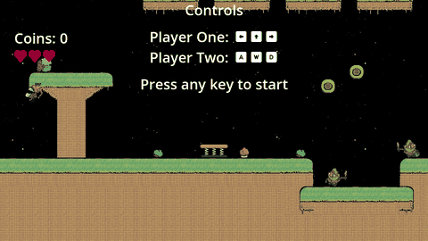
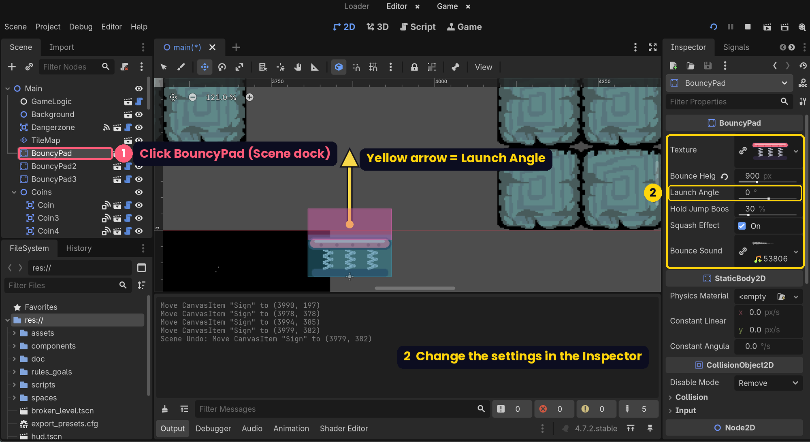

# Threadbare + Godot Challenge

**Next-Gen Summit 2026** · Make your own game in the browser, use the **Bouncy Pad**, and share it in the Game Gallery.

You only need **3 steps**. Use **Chrome or Edge on a laptop or desktop computer**. No installing, no account.

---

## Step 1 · Download the game and open it

1. **Download the game:** 👉 **[moddable-platformer-bouncy.zip](https://github.com/yche1364-YJ/Next-Gen-Summit-2026/raw/main/downloads/moddable-platformer-bouncy.zip)**
   Keep it as a ZIP. **Don't unzip it.**
2. **Open the Godot web editor:** 👉 **https://editor.godotengine.org/releases/latest/**
   If a notice appears, click **OK - Don't Show Again**.
3. Next to **Preload project ZIP**, click **Choose File** and pick the ZIP you downloaded.
4. Click **Start Godot Editor** and wait a few seconds.
5. The game opens. Click **2D** at the top to see the level, and press **F5** to play.

> 💾 **Save your work every time!** Your game is saved **only inside this browser**. Before you leave, click **Project → Tools → Download Project Source** to download a ZIP of your game.
> Next time, open the web editor and choose **your** ZIP in step 3 instead.

---

## Step 2 · Make your game (use the Bouncy Pad!)

Your game **must use the Bouncy Pad**, a trampoline that launches the player. There's already one in the level.

**Where is it?** In the **Scene** list (top left), click **`BouncyPad`**. Its settings appear in the **Inspector** (right).

**The 3 most important settings:**

| Setting | What it does |
|---|---|
| **Bounce Height** | How high the player flies, in pixels. A normal jump is about 395. |
| **Launch Angle** | Tilts the bounce direction, in degrees. A yellow arrow in the editor shows where the player will fly. |
| **Rotation** (under **Transform**) | Turns the pad. **90** or **-90** makes a **bouncy wall**; **45** makes a slope. |

**More pads:** select `BouncyPad` and press **Ctrl+D** (**Cmd+D** on Mac) to copy it, then drag the copy somewhere new.

📖 **[Bouncy Pad full guide](docs/bouncy-guide.md)**: change its picture and sound, make any object bouncy, challenges and help.

---

## Step 3 · Submit your game to the Gallery

👉 **[Upload your game](https://yche1364-yj.github.io/Next-Gen-Summit-2026/upload.html)**. Each team uploads once; no account needed.

1. In Godot, click **Project → Tools → Download Project Source** to get your game's ZIP.
2. Open the upload page, fill in your team and game, and choose your ZIP.
3. Click **Upload my game**. After your teacher checks it, your game appears in the **[Game Gallery](https://yche1364-yj.github.io/Next-Gen-Summit-2026/)**.

📖 **[Submission step by step](docs/submit-guide.md)**

---

## Want to learn more?

Play **Threadbare**, the open-source game made with Godot, and find more ways to learn and create: 👉 **[Threadbare by Endless Access](https://access.endlessstudios.com/games/threadbare)**

---

👩‍🏫 Teachers: [Teacher area](docs/teachers/README.md) · Based on [Moddable Platformer](https://github.com/endlessm/moddable-platformer) by Endless Access (MIT)
