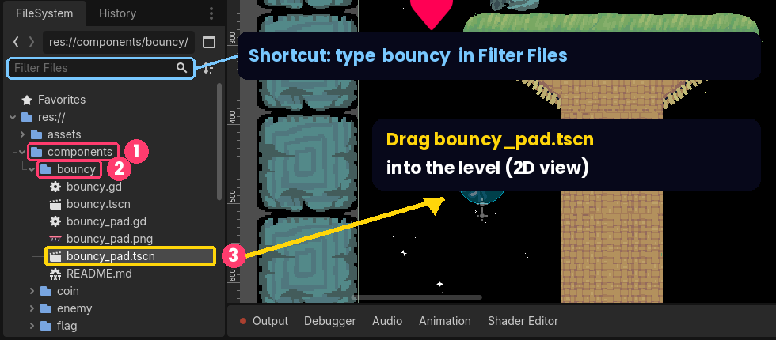
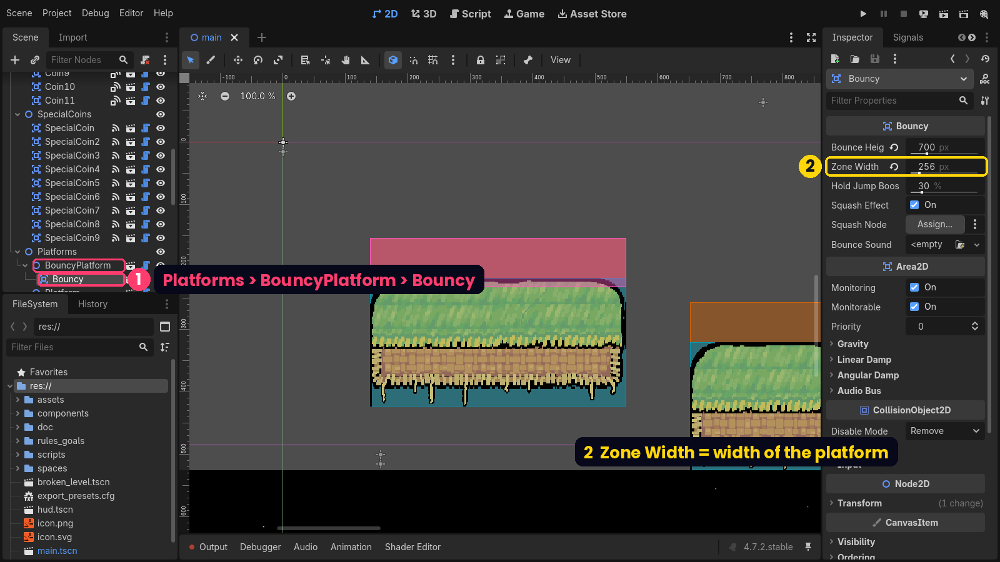
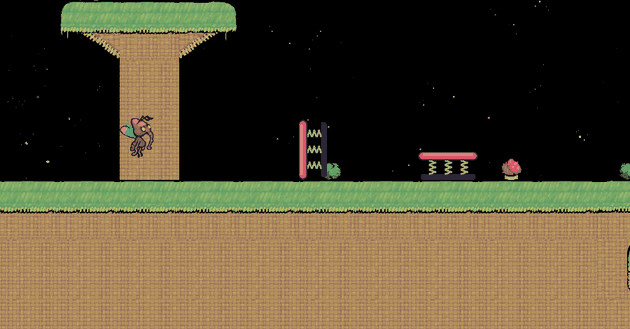
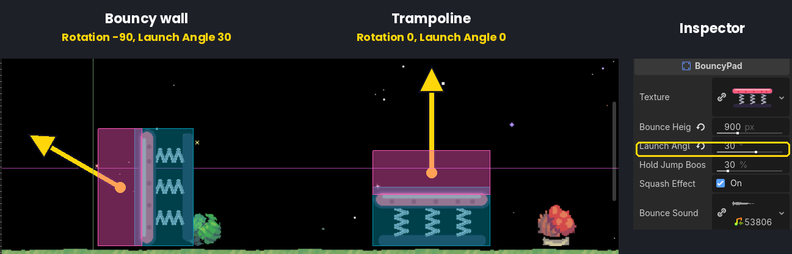

# Bouncy Pad · Full guide

[← Back to the 3 steps](../README.md)

Everything about the **Bouncy Pad** (the trampoline) and the **Bouncy component** (make anything bouncy).

- [Where is the Bouncy Pad?](#where-is-the-bouncy-pad)
- [Bouncy walls and slopes](#bouncy-walls-and-slopes)
- [All the settings](#settings-in-the-inspector)
- [Change the picture](#change-the-trampolines-picture) · [Change the sound](#change-the-sound)
- [Challenges to try](#challenges-to-try)
- [Help: something isn't working](#troubleshooting)
- [How it works (for the curious)](#how-it-works)

---

## Where is the Bouncy Pad?

> ⚠️ **The Godot web editor starts empty.** The Bouncy asset is **inside our game project**, not in the editor and not in the **Asset Store**. You only see it after loading **`moddable-platformer-bouncy.zip`** (see [Step 1](../README.md#step-1--download-the-game-and-open-it)).

**It's already in the level.** When the project opens, the main level (`main.tscn`) already has a trampoline and a bouncy platform. To edit them:

- **In the Scene dock** (top left), click **`BouncyPad`** (near the top, just below `TileMap`) — or click the pink trampoline in the 2D view.
- For the bouncy platform, expand **`Platforms`** → **`BouncyPlatform`** and click **`Bouncy`**.
- Their settings appear in the **Inspector** on the right (see [Settings in the Inspector](#settings-in-the-inspector)).


**Want more trampolines?** Select `BouncyPad` and press **Ctrl+D** (**Cmd+D** on Mac) to duplicate it, then drag the copy somewhere else. Or drag a new one in from the **FileSystem** dock (bottom left): open **`components`** → **`bouncy`** and **drag `bouncy_pad.tscn` into the level**:



**Shortcut:** type `bouncy` in the **Filter Files** box at the top of the FileSystem dock.

### No `bouncy` folder? Add it to your project

If there's no `components/bouncy` folder, you loaded the **original** Moddable Platformer instead of our version. You don't have to start over:

1. Download **[`bouncy-asset.zip`](https://github.com/yche1364-YJ/Next-Gen-Summit-2026/raw/main/downloads/bouncy-asset.zip)** and **unzip it** on your computer. You get a folder called **`bouncy`**.
2. In the Godot web editor, **drag the `bouncy` folder** from your computer onto the **`components`** folder in the FileSystem dock.
3. Check that you now have `components/bouncy/bouncy_pad.tscn`. Done!

> The folder must end up exactly at `components/bouncy/` — the files expect that location.

There are two ways to make things bouncy:

| | **Option 1: Bouncy Pad** | **Option 2: Bouncy component** |
|---|---|---|
| File | `components/bouncy/bouncy_pad.tscn` | `components/bouncy/bouncy.tscn` |
| What it is | A ready-made trampoline | A bounce zone you attach to **any** object |
| Good for | Getting started quickly | Making platforms, enemies, rocks… bouncy |

## Option 1: Add a trampoline (Bouncy Pad)

1. Open a level, for example `main.tscn`, and make sure you're in the **2D** view.
2. Duplicate the existing `BouncyPad` (**Ctrl+D**), **or** drag `components/bouncy/bouncy_pad.tscn` from the FileSystem dock into the level.
3. Move it so it **sits on the ground**. The trampoline's origin (the point you drag) is at the **bottom-centre** of the picture.
4. With the trampoline selected, change its settings in the **Inspector** on the right.
5. Press **F5** to test it.

*In the editor, the pink box is the bounce zone and the blue box is the solid part you can stand on. All the settings you need are at the top of the Inspector.*

## Option 2: Make any object bouncy (Bouncy component)

1. In the **Scene** dock (top left), **right-click** the object you want to make bouncy — for example one of the `Platform` nodes — and choose **Instantiate Child Scene**.
2. Pick `components/bouncy/bouncy.tscn`. A new **Bouncy** node appears under your object.
3. Move the Bouncy node to the object's **top surface**. The **pink box** should stick out slightly above the surface. For a Platform, set the Bouncy node's **Position y** to **-64**.
4. Make the pink box **as wide as the object**: in the Inspector, set **Zone Width**. A Platform is **128 px per tile**, so a Platform with `Width` 2 needs **256**.
5. Change the other settings in the **Inspector**.
6. Press **F5** to test.



*In the main level, `Platforms/BouncyPlatform` has a `Bouncy` child with Zone Width 256. The pink bounce zone covers the platform's whole top surface.*

> **Tip:** you can attach Bouncy to almost anything — a platform, a sign, the flag, even an enemy. The player bounces whenever they land on the pink zone from above.

## Bouncy walls and slopes

**Rotate a trampoline and it becomes a bouncy wall or slope.** It always launches the player out of its pink face, in whatever direction it points.



1. Select the trampoline (for example duplicate `BouncyPad` with **Ctrl+D** first).
2. In the **Inspector**, open **Transform** and set **Rotation**:
   - **-90** → a wall that pushes the player **left** (its face points left)
   - **90** → a wall that pushes the player **right**
   - **45** or **-45** → a slope that launches diagonally
3. Move it so its pink face points where the player comes from.
4. *(Optional)* Set **Launch Angle** to tilt the direction further — for example so a wall pushes the player out **and** up.
5. Press **F5** and run into it.

In the editor, a **yellow arrow** shows exactly where the player will be launched, so you can see the effect of Rotation and Launch Angle without playing. (The arrow is only visible in the editor, not in the game.)



> **Rotation and Launch Angle add up.** Rotation turns the whole trampoline (what you see); Launch Angle only turns the launch direction. Positive Launch Angle tilts clockwise, negative counterclockwise — just watch the arrow.

---

## Settings in the Inspector

| Setting | What it does | Default | Bouncy Pad | Bouncy component |
|---|---|---|:-:|:-:|
| **Bounce Height** | How hard the player is launched. Lying flat with Launch Angle 0, it's exactly how high they go, **in pixels**. For comparison, a normal jump is about **395 px**. | 600 (in the level: 900 for the pad, 700 for the platform) | ✓ | ✓ |
| **Launch Angle** | Tilts the launch direction, in degrees. 0 = straight out of the bouncy face. Positive tilts clockwise, negative counterclockwise; the yellow arrow in the editor shows the result. With a tilt, part of the force goes sideways, so the player goes less high. | 0 | ✓ | ✓ |
| **Zone Width** | How wide the pink bounce zone is, in pixels. Make it as wide as the object. | 128 | (automatic) | ✓ |
| **Hold Jump Boost** | Extra height (in %) if the player is holding the jump key when they land. Set to 0 to turn it off. | 30% | ✓ | ✓ |
| **Squash Effect** | Squashes and stretches the picture when someone bounces on it. | On | ✓ | ✓ |
| **Squash Node** | Which node gets squashed. If empty, the Bouncy node's parent is squashed. | (parent) | — | ✓ |
| **Bounce Sound** | Sound played on each bounce. The pad uses the game's "boing" sound. | boing / none | ✓ | ✓ |
| **Texture** | The trampoline's picture. | Pink trampoline | ✓ | — |

Because **Bounce Height** is measured in pixels, you can look at the ruler at the top/left of the 2D view to see exactly how high the player will go (for a flat trampoline with Launch Angle 0).

The **Rotation** in the Transform section (every object has it) turns a trampoline into a wall or slope — see [Bouncy walls and slopes](#bouncy-walls-and-slopes).

## Change the trampoline's picture

1. Draw or find a **PNG** image. Good guidelines:
   - Around **64–256 pixels wide** (the default is 128 × 64).
   - A **transparent background**.
   - **No empty space around the edges** — the solid area is the whole picture, so empty margins become invisible walls.
   - Draw it the way it should sit on the ground; the bottom edge of the picture is placed on the floor.
2. **Drag the PNG file from your computer into the FileSystem dock** in the editor (the `components/bouncy/` folder is a good place).
3. Select your trampoline in the level.
4. **Drag the PNG from the FileSystem dock onto the Texture field** in the Inspector.

The solid area and the bounce zone **resize automatically** to fit your picture. To go back to the original, right-click the Texture field → **Clear**.

> You can have many trampolines with different pictures and heights in the same level — each one has its own settings.

## Change the sound

- **Different sound:** drag an `.ogg` or `.wav` file into the FileSystem dock, then drag it onto the **Bounce Sound** field. The game's existing sounds are in `assets/sounds/`.
- **No sound:** right-click the **Bounce Sound** field → **Clear**.

## Change how the Bouncy component looks or works on an object

- **Wider/narrower bounce zone:** change **Zone Width** in the Inspector.
- **Squash only part of an object:** set **Squash Node** to the picture (for example a `Sprite2D`) instead of the whole object.
- **No squash:** untick **Squash Effect**. This is a good idea on large objects or on platforms that move.

---

## Challenges to try

1. **Match the jump:** set Bounce Height to **395**. Does the bounce now feel exactly like a normal jump?
2. **Gravity experiment:** select **GameLogic** in `main.tscn` and lower its **Gravity**. Bounce again. The bounce height stays the same — but how does it *feel*? (Hint: you float longer.)
3. **Reach the secret coin:** there's a coin floating high above the start of the level. Place trampolines so the player can reach it without the falling platforms.
4. **Bounce chain:** build a path where the player has to bounce from pad to pad without touching the ground.
5. **Super bounce only:** set a pad's Bounce Height low (for example 200) and Hold Jump Boost high (for example 200%). Now the player *must* hold jump to get over the obstacle.
6. **Make your own design:** draw a mushroom, a jelly, a spring or a cloud and use it as your trampoline's picture.
7. **Bouncy enemy:** attach the Bouncy component to an enemy. What changes about the game?
8. **Wall climb:** put two bouncy walls facing each other (Rotation 90 and -90) with Launch Angle tilted upwards. Can the player bounce back and forth to climb up?
9. **Same force, different angle:** keep Bounce Height the same and try Launch Angle 0, 30, 45 and 60 on a flat trampoline. Which angle sends the player farthest? Which goes highest?
10. **Get past the big wall:** at the end of the level a sign asks *"How can I get past this wall?"* Can you get over it using only trampolines?

---

## Troubleshooting

| Problem | Solution |
|---|---|
| The editor won't start or shows a warning about missing features | Use an up-to-date **Chrome or Edge** on a computer. |
| A long warning listing files that *"failed extraction from package"* appears | You probably clicked **Install** twice. Click OK; the project from the first click is fine. |
| *"The selected path is not empty"* | Change the **Project Name** in the Install window to a new name. |
| The editor shows an empty 3D grid | Click **2D** at the top of the screen. |
| The keyboard doesn't control the player | Click once on the game picture first. |
| I can't find the Bouncy Pad | It's in `components/bouncy/` — see [Where is the Bouncy Pad?](#where-is-the-bouncy-pad) |
| The player doesn't bounce on my object | Make sure the pink box is on the **top** surface and sticks out a little above it, and that it's as wide as the object. |
| My project disappeared | It was stored in the browser. Load your last **Download Project Source** ZIP using Preload project ZIP. |
| My custom picture has invisible walls | Crop the empty transparent space around the picture. |

---

## How it works

*(For anyone curious about the code — you don't need this to use the asset.)*

The **Bouncy component** (`bouncy.gd`) is an **Area2D**, an invisible detection zone (the pink box). When a player enters the zone **while moving towards its face** (falling onto it, for a flat trampoline), the script changes the player's speed so they fly out of the face:

```gdscript
var speed := sqrt(2.0 * gravity * height)
character.velocity = launch_direction() * speed
```

This is the physics formula **v = √(2gh)**: the starting speed you need to reach height *h* when gravity is *g*. That's why you only type a *height* — the script works out the speed for you, using the game's current gravity. The direction comes from the object's rotation plus **Launch Angle**. (In Godot, negative *y* means "up".)

A few details that make it feel right:

- It only bounces players who are **in front of** the face and **moving towards it**, so jumping up through a one-way platform or touching a wall from behind does nothing.
- After a sideways launch, the player can't steer left/right for **0.4 seconds**. Otherwise the Player script would brake the sideways movement almost instantly and a bouncy wall would barely push. Bouncy does this by briefly changing the Player's own *Acceleration* setting, so the original Player script didn't need to change.
- The original Player script briefly stops gravity right after touching the ground ("coyote time"); Bouncy resets that timer so the bounce height is accurate.
- After each bounce it emits a `bounced` signal, which other scripts can connect to (for example to count bounces or play an effect).

The **Bouncy Pad** (`bouncy_pad.gd`) is a solid **StaticBody2D** with a picture and a Bouncy component inside. Whenever you change its Texture, it measures the picture and resizes its collision shape and bounce zone to match.

Both scripts are short and fully commented — open them from `components/bouncy/` in the editor (or read them in [`bouncy-code/`](bouncy-code/)).

We tested the bounce height with automated tests in Godot 4.7.2: the measured height is within about 2% of the Bounce Height setting (including with changed gravity and with the hold-jump boost). We also tested walls facing left and right, 45° slopes and Launch Angles: the player is launched at exactly the angle the arrow shows, and touching a wall from behind does nothing.

---

## Using Bouncy in another Godot project

The files in [`bouncy-code/`](bouncy-code/) are written for **this** game. To use them in a different Godot 4 project:

1. Copy them into your project at **`res://components/bouncy/`** (the scenes refer to that path).
2. Make sure your player is a **CharacterBody2D** in the **`players`** group.
3. `bouncy.gd` uses two things from this game that you'll need to replace:
   - `Global.PhysicsLayers.PLAYER` — replace it with your player's physics layer number.
   - `Actions.lookup(character.player, "jump")` — replace it with your jump action name, for example `"ui_accept"`.
4. `bouncy_pad.tscn` uses the sound `res://assets/sounds/538066__stevielematt__boing.ogg`; point it to your own sound or clear it.
